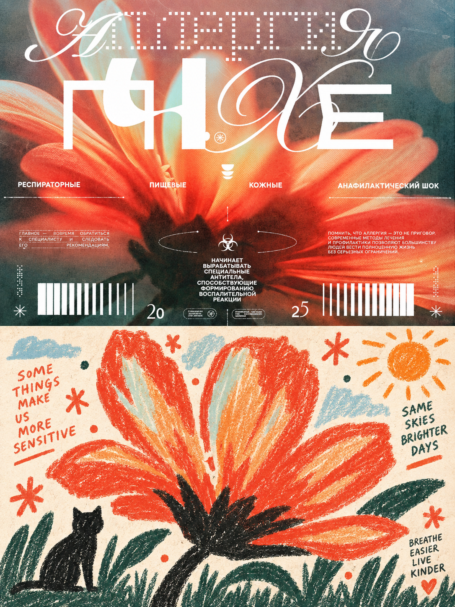
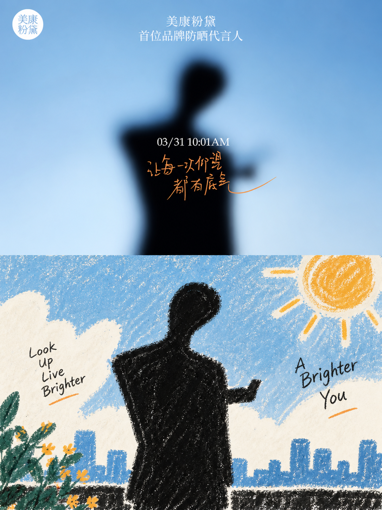
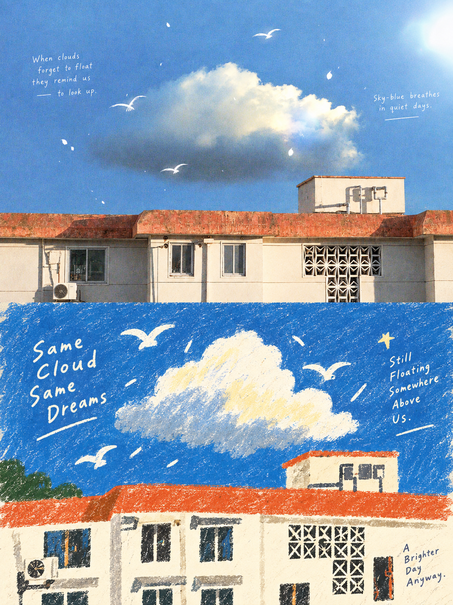
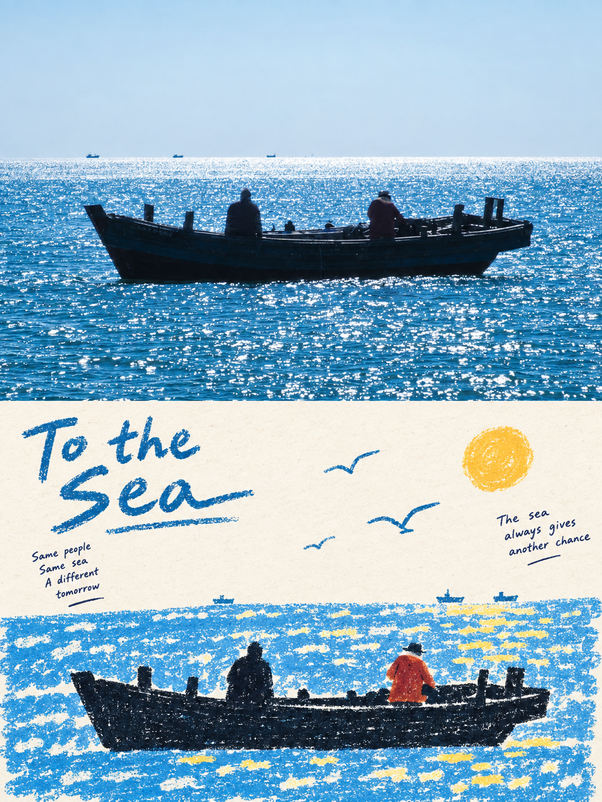
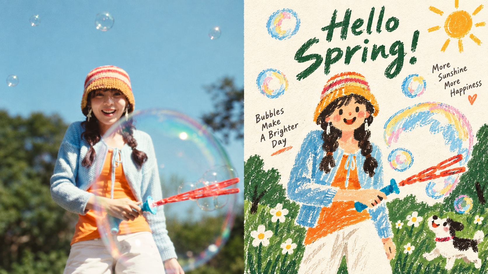
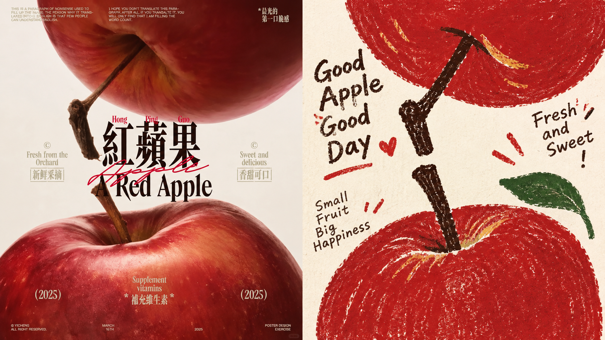
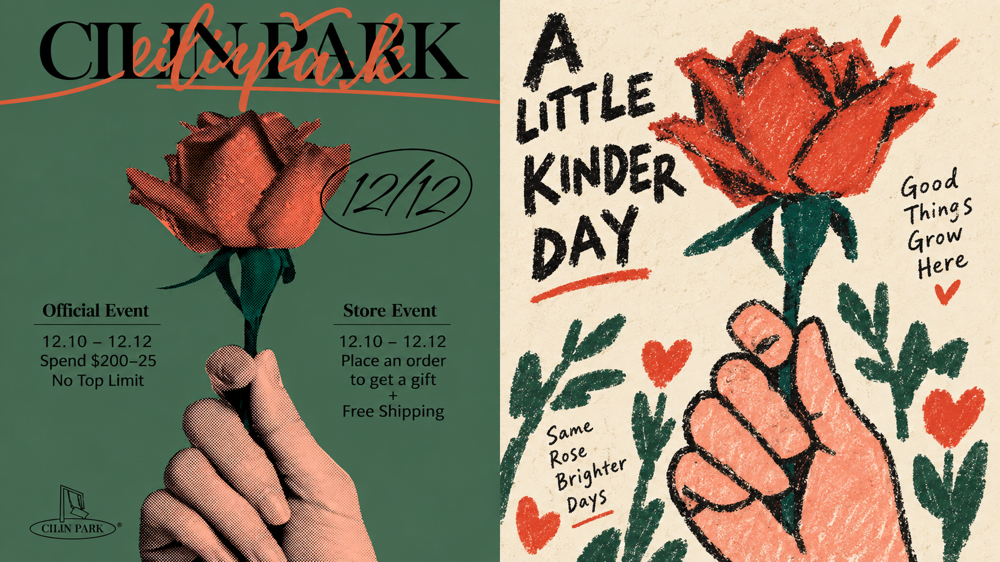
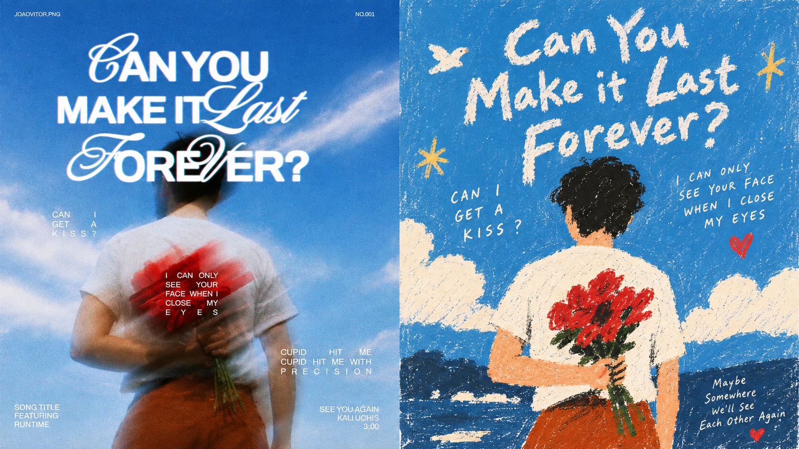

<div align="center" dir="rtl">

# XXD Panel 100｜لوحة سردية من الفنون الشعبية

**يحوّل الصورة إلى حكاية شعبية صغيرة ساذجة، بحبيبات الطباشير الشمعي وروح الحياة اليومية.**

<a href="README.md">简体中文</a> · <a href="README.en.md">English</a> · <a href="README.ja.md">日本語</a> · <a href="README.ko.md">한국어</a> · <strong>العربية</strong>

</div>

<div dir="rtl">

<table>
  <tr>
    <td width="50%"></td>
    <td width="50%"></td>
  </tr>
</table>

<p align="center"><sub>في الأعلى الصورة الأصلية، وفي الأسفل الصورة نفسها بهذا الأسلوب.</sub></p>

## ما هذا

مهارة (Skill) لوكلاء الذكاء الاصطناعي مثل Claude Code وCodex. أعطها صورة فترسم عملاً نهائياً بصيغة PNG وفق الموجّه الأصلي للوحة 100.

- **كيف تبدو النتيجة:** يُضغط العنصر في ظلال بسيطة وأشكال بدائية كبيرة بملامح مبالغ فيها؛ الفضاء مسطح، تُروى فيه الحكاية بالارتفاع والتداخل والحجم، وتتناثر الأشياء الصغيرة حوله كأنها رموز. تُملأ المساحات الداكنة بالطباشير الشمعي أو الباستيل الزيتي أو القلم الرصاص الطري، ممسوحة ومتراكبة ومتقطعة يظهر من خلالها الورق، بحواف فيها شيء من الارتباك. الأرضية ورق أبيض دافئ، ولا يُستعمل إلا عدد قليل من أكثر ألوان الصورة حيوية، بلمسات صغيرة على الثياب أو النباتات أو الطعام أو نقطة التركيز. النص قليل، بخط شعبي تحريري بسيط فيه أخطاء الطباعة اليدوية، مع خط يد أحياناً، ويظهر كلافتة أو قائمة طعام أو ورقة ملاحظة داخل المشهد.
- **كلمات مفتاحية:** أشكال بدائية · ظلال مبسطة · منظور مسطح · حبيبات الطباشير والباستيل الزيتي · ورق أبيض دافئ · ألوان زاهية محدودة
- **ما يمكنك صنعه:** مقارنة علوية سفلية (الصورة فوق والتصميم تحت)، أو مقارنة يمين ويسار، أو التصميم وحده، أو مجموعة خلفيات للهاتف والجهاز اللوحي والحاسوب والساعة. يمكنك اختيار أكثر من نوع وبأي نسبة أو أبعاد.
- **ما ليس هو:** ليس فلتراً ولا قالباً: كل صورة تُرسم من جديد من صورتك، وكل صورة مهمة مستقلة.

## ابدأ في ثلاث خطوات

**1. التثبيت.** يعمل مع Claude Code وCodex وغيرهما من الوكلاء الداعمين للمهارات:

```bash
npx skills add https://github.com/nevertoday/xxd-panel-100 --skill xxd-panel-100
```

ثم أعد تشغيل جلسة الوكيل. يمكنك أيضاً تنفيذ `git clone` لهذا المستودع وربط المجلد بـ `~/.claude/skills/xxd-panel-100` أو `~/.codex/skills/xxd-panel-100`.

**2. تأكد أن وكيلك يستطيع توليد الصور.** لا تحتوي هذه المهارة على نموذج صور خاص بها، بل تستخدم قدرة وكيلك على توليد الصور، ويُفضَّل GPT Image 2.

- يعمل Codex مباشرة عندما يكون توليد الصور المدمج مفعّلاً.
- أما Claude Code والوكلاء الذين لا يملكون توليد صور مدمجاً فيحتاجون إلى واجهة صور متوافقة مع OpenAI، ويستغرق الإعداد نحو خمس دقائق: راجع [إعداد توليد الصور](#إعداد-توليد-الصور).

لست متأكداً؟ جرّب مباشرة. إذا تعذّر التوليد فستتوقف المهارة وتخبرك قبل أن تبدأ أي عمل.

**3. أرسل صورة وقل جملة واحدة:**

> استخدم xxd-panel-100 لتحويل هذه الصورة إلى ملصق علوي سفلي بنسبة 3:4 مع عنوان بالعربية.

إذا كان طلبك كاملاً فسيبدأ فوراً، وما تركته (التخطيط أو النسبة أو النص) سيسألك عنه في سؤال أو سؤالين عادةً. تُحفظ النتائج بصيغة PNG في مجلد جديد داخل `~/Desktop/xxd/xxd-panel-100/`.

## الصور الأنسب

**تناسبه**

- صور يومية فيها فعل أو علاقة محورية واحدة: شخص يطبخ، بسطة طعام في الشارع، شخصان يمشيان يداً بيد
- مشاهد فيها نبض الحياة: ركن في سوق، ألحفة تُنشر في فناء، واجهة دكان صغير
- أشخاص وحيوانات وأشياء بظلال واضحة: راكب دراجة، دجاجة، إبريق شاي

**لا تناسبه كثيراً**

- الصور الشخصية التي تحتاج إلى ملامح دقيقة أو شبه مطابق
- صور تقوم على منظور معقد أو تفاصيل كثيرة: أفق المدينة، الآلات، المشاهد الداخلية الكاملة
- طلب كرتون أطفال أو ملصقات لطيفة أو متجهات لامعة أو رسم واقعي

## نماذج

كل صورة أدناه نتيجة نهائية صنعتها هذه المهارة من صورة واحدة. استُخدمت صور مختلفة للمقارنات العلوية السفلية والجانبية.

### علوي سفلي: الصورة فوق والتصميم تحت

<table>
  <tr>
    <td width="50%"></td>
    <td width="50%"></td>
  </tr>
  <tr>
    <td width="50%"></td>
    <td width="50%"></td>
  </tr>
</table>

### يمين ويسار: الصورة يساراً والتصميم يميناً

<table>
  <tr>
    <td width="50%"></td>
    <td width="50%"></td>
  </tr>
  <tr>
    <td width="50%"></td>
    <td width="50%"></td>
  </tr>
</table>

## قلها ببساطة

لا حاجة إلى حفظ المعاملات. قل ما تريد:

| تريد | قل |
|---|---|
| مقارنة علوية سفلية | اجعلها مقارنة علوية سفلية بنسبة 3:4 |
| مقارنة يمين ويسار | اجعلها مقارنة جانبية 16:9 والصورة على اليسار |
| التصميم فقط | التصميم فقط بلا صورة، عمودي 9:16 |
| مجموعة خلفيات | خلفيات متناسقة للهاتف والجهاز اللوحي والحاسوب والساعة |
| عدة نسب | اصنع هذه الصورة بنسب 1:1 و3:4 و16:9 |
| نصك أنت | العنوان «دع الريح تمر» كما هو حرفياً |
| بلا نص | بدون أي نص |
| لغة النص | اكتب النص باليابانية |
| مجلد كامل | حوّل كل صور هذا المجلد إلى مقارنات علوية سفلية |
| مثل المرة السابقة | استخدم إعداداتي السابقة |

تفضّل سطر الأوامر؟ المعاملات تقابل ما سبق واحداً بواحد:

```text
/xxd-panel-100 photo.jpg --mode top-bottom --size 3:4 --text prompt --locale ar
/xxd-panel-100 photo.jpg --mode design-only --size 9:16 --text none
/xxd-panel-100 ./photos --mode left-right --size 16:9 --text prompt --locale en-US
```

كل المعاملات في قسم [المعاملات](#المعاملات).

## أسئلة شائعة

**هل يجب أن تظهر الصورة الأصلية؟** لا. اطلب «التصميم فقط» أو مجموعة خلفيات فتصبح اللوحة كلها تصميماً.

**من يكتب النص؟** افتراضياً يكتبه نموذج الصور انطلاقاً من صورتك، وأنت تختار اللغة فقط. إن أعطيته كلماتك استُخدمت حرفياً، ويمكنك طلب عدم وجود نص. أي معلومة تبدو واقعية (أماكن، تواريخ، أرقام) تأتي منك أو مما يظهر في الصورة فقط، ولا تُختلق.

**ماذا لو لم تعجبني النتيجة؟** قل «واحدة أخرى». يعيد الرسم من الصورة الأصلية بدلاً من تعديل النتيجة السابقة، لذا تختلف كل محاولة.

**هل تختلط الصور في الدفعة الواحدة؟** لا. تُولَّد كل صورة وحدها ولا تستعير ألوان صورة أخرى أو نصها أو تكوينها. وتُسأل عن الإعدادات مرة واحدة للدفعة كلها.

**إلى أين تذهب صوري؟** إلى نموذج الصور الذي يستخدمه وكيلك فقط. لا ترفع المهارة شيئاً إلى أي مكان آخر ولا تعرض العناوين أو المفاتيح.

**ما علاقة هذا بلوحات Panel الأخرى؟** لوحات XXD Panel عائلة من الأساليب، لكل رقم أسلوب مستقل، فثبّت ما يعجبك فقط. لتدع الذكاء الاصطناعي يقترح أسلوباً لصورة أو تقارن عدة أساليب، استخدم الفهرس [xxd-panel-all](https://github.com/nevertoday/xxd-panel-all).

## الموجّه الأصلي

يحدّد هذا الأسلوبَ بالكامل [الموجّهُ الأصلي](references/original-prompt/zh-CN.md) الذي كتبه شياوشياودونغ (بالصينية). تضيف المهارة في آخره فقط إعدادات التخطيط والحجم والنص التي تختارها، ولا تلخّصه أو تترجمه أو تعيد كتابته.

ترجمات للقراءة (للاطلاع فقط ولا تُرسل إلى نموذج الصور): [English](references/original-prompt/en.md) · [日本語](references/original-prompt/ja.md) · [한국어](references/original-prompt/ko.md) · [العربية](references/original-prompt/ar.md)

## إعداد توليد الصور

تحتاج إلى واجهة متوافقة مع OpenAI تقدّم `gpt-image-2` (أو نموذجاً متوافقاً) ومفتاح API لها. الخطوات التالية تنشئ إعداداً منفصلاً ولا تمس إعدادات Codex:

```bash
mkdir -p ~/.xxd-imagegen
cat > ~/.xxd-imagegen/config.toml <<'EOF'
model_provider = "image"

[model_providers.image]
base_url = "https://api.openai.com/v1"   # or your compatible endpoint
env_key = "XXD_IMAGE_API_KEY"
EOF

# add to ~/.zshrc or ~/.bashrc so your agent can read them
echo 'export XXD_IMAGEGEN_CODEX_DIR=~/.xxd-imagegen' >> ~/.zshrc
echo 'export XXD_IMAGE_API_KEY=your-key' >> ~/.zshrc
```

أعد فتح الطرفية والوكيل، ثم تحقّق مرة واحدة من مجلد هذه المهارة:

```bash
python3 scripts/configured_imagegen.py probe
```

إذا ظهر `"ok":true` فقد نجح الإعداد. يعرض الفحص الجاهزية فقط ولا يطبع العنوان أو المفتاح. إذا كان Codex يولّد الصور أصلاً عبر واجهة متوافقة فلا حاجة إلى هذه الخطوة.

## المعاملات

| المعامل | القيم |
|---|---|
| `--mode` | `top-bottom` علوي سفلي · `left-right` يمين ويسار · `design-only` التصميم فقط · `wallpaper-pack` خلفيات لأربعة أجهزة؛ يمكن الجمع |
| `--size` | `auto` موصى به · `source` مثل الصورة · `1:1` `3:4` `4:3` `4:5` `5:4` `2:3` `3:2` `9:16` `16:9` `21:9` `5:7` `7:5` · أبعاد دقيقة مثل `2160x3840`؛ يمكن الجمع |
| `--text` | `prompt` يُكتب من الصورة · `exact` كلماتك (مع `--copy "…"`) · `none` بلا نص |
| `--locale` | لغة النص، مثل `zh-CN` `en-US` `ja-JP` `ko-KR` `ar` |
| `--wallpaper` | `linked` مجموعة متناسقة · `independent` أربعة تصاميم مستقلة |
| `--wallpaper-size` | أبعاد كل جهاز، مثل `phone=1440x3200,desktop=3840x2160` |
| `--out` | مجلد إخراج آخر (الافتراضي `~/Desktop/xxd/xxd-panel-100/`) |
| `--prefs` | `last` كالسابق · `edit` تعديل السابق · `new` اختيار جديد · `off` لا تحفظ هذه المرة · `clear` امسح السجل |

- إذا اكتملت القيم فلا أسئلة، وإلا تُسأل عن الناقص فقط. مرّر مجلداً بدلاً من `photo.jpg` للمعالجة الدفعية.
- تُولَّد التركيبات واحدة واحدة: نمطان × ثلاثة أحجام = 6 صور، كل منها مركّبة للوحتها لا مقصوصة.
- المقارنات 50:50 بدقة. عادةً يرسم النموذج نصف التصميم فقط ويضع برنامج الصورة الأصلية كما هي بجانبه، فيكون الفاصل في المنتصف ولا تتغير الصورة.
- أسماء الملفات بهذا الشكل `source-001-street-top-bottom-3x4-1152x1536.png`، وكلها في مجلد مهمة واحد.
- يُحفظ التخطيط والحجم وطريقة النص واللغة فقط، ولا تُحفظ الصور أو النصوص أو المفاتيح.

<!-- xxd-readme-ads:start -->
## عن XXD

XXD هو اختصار اسم علامة Xiaoxiaodong. أنشأ هذا المشروع ويديره [@xiaoxiaodong01](https://x.com/xiaoxiaodong01).

## عضوية Xiaoxiaodong متعددة المنصات · 699 يواناً صينياً سنوياً

> **إفصاح إعلاني:** رمز QR وروابط العضوية والخدمات المدفوعة أدناه معلومات ترويجية من XXD. المسح أو الشراء اختياري تماماً ولا يؤثر في استخدام المشروع المفتوح المصدر.

تفتح عضوية سنوية واحدة ثلاث مزايا معاً: **Knowledge Planet + مكتبة توجيهات أعضاء XXD + عضوية جميع Skills من مستوى General**. المزايا الثلاث ضمن عضوية واحدة ولا يلزم شراء منفصل.

<!-- xxd-panel-command-system:start -->

### كيف تتعاون الـ Skills

| المستوى | ما يتضمنه | المهمة |
|---|---|---|
| **General** | [`xxd-panel-all`](https://github.com/xiaoxiaodong-ai/xxd-panel-all) | يكتشف Skills المرقمة المتاحة، ويرشحها حسب الصورة أو الموضوع أو الاستخدام، وينظم المهام متعددة الأساليب والدفع بالجملة. |
| **Soldier** | `xxd-panel-NNN` | تنفذ كل مهارة مرقمة موجّهها الأصلي وجماليتها الخاصة، وتنجز المهمة المحددة التي يوزعها General. |

<!-- xxd-panel-command-system:end -->

### ماذا تحصل عليه

1. **استشارات فردية عبر WeChat لتعلّم الذكاء الاصطناعي والمشاريع**
   أضف Xiaoxiaodong على WeChat عبر رمز QR أدناه للتواصل الفردي حول تعلّم الذكاء الاصطناعي والأدوات والمشاريع العملية والحصول على إرشادات وإجابات مفيدة. يمكن تنظيم الأسئلة المميزة ضمن محتوى الأعضاء.
2. **مكتبة توجيهات للأعضاء تتوسع باستمرار**
   تضم [مكتبة توجيهات أعضاء XXD](https://vip.xiaoxiaodong.ai/) حالياً نحو 32 ألف توجيه، وستواصل التنظيم والتوسع بهدف تجاوز 100 ألف.
3. **جميع Skills من مستوى General ودعم الاستخدام**
   تغطي عضوية واحدة جميع Skills من مستوى General، مع إرشادات ودعم للأسئلة عند الحاجة.
4. **أولوية للطلبات شديدة الاحتياج**
   تُراجع التوجيهات والـ Skills ذات الطلب المرتفع والاحتياج الفعلي وتُطوّر أولاً حيثما كان ذلك مناسباً.

### كيفية الاشتراك

- [فعّل العضوية ذاتياً من موقع الأعضاء](https://vip.xiaoxiaodong.ai/).
- أو امسح رمز QR أدناه لإضافة Xiaoxiaodong على WeChat والحصول على دعم فردي للتفعيل.

<p align="center"><a href="https://xiaoxiaodong.pages.dev/assets/wechat-qr.png"></a></p>
<!-- xxd-readme-ads:end -->

## الترخيص

يُقدَّم هذا المشروع — بما في ذلك Skill والموجّهات والبرامج النصية والوثائق والعينات المرفقة — بموجب **PolyForm Noncommercial License 1.0.0**. النص القانوني الكامل موجود في [LICENSE](LICENSE)، والصفحة الرسمية هي <https://polyformproject.org/licenses/noncommercial/1.0.0>.

بكلمات واضحة:

- يُسمح بالاستخدام الشخصي للدراسة والبحث والتجربة والاختبار والهوايات والترفيه الخاص. ويُسمح أيضاً باستخدامه من الجمعيات الخيرية والمؤسسات التعليمية ومنظمات البحث أو السلامة أو الصحة العامة ومنظمات حماية البيئة والمؤسسات الحكومية.
- لأغراض **غير تجارية**، يمكنك الاستخدام والنسخ والتعديل وإنشاء أعمال مشتقة ومشاركة المشروع. عند المشاركة، أرفق هذا الترخيص (أو الرابط أعلاه) وكل سطر `Required Notice:` يقدمه المؤلف.
- لا يُسمح بالمنتجات أو الخدمات التجارية، أو التسليم بمقابل، أو بيع حق الوصول أو التراخيص، أو أي استخدام متوقَّع له تطبيق تجاري. للاستخدام التجاري، احصل أولاً على إذن كتابي منفصل من صاحب حقوق النشر.
- يمنح الترخيص حقوق النشر وحقوق براءة الاختراع المحدودة المذكورة فقط. لا يمنح حقوق العلامات التجارية أو أسماء العلامات أو أي حقوق أخرى غير منصوص عليها، ولا يجوز إعادة ترخيصه أو نقل ترخيصك.
- عند تلقي إخطار كتابي بالمخالفة، لديك 32 يوماً للامتثال الكامل واتخاذ خطوات عملية للتصحيح؛ وإلا تنتهي التراخيص. كما ينهي الادعاء الكتابي بانتهاك براءة اختراع ترخيص البراءة.
- يُقدَّم المشروع **كما هو**، بلا ضمانات إلى الحد الذي يسمح به القانون، وتتحمل أنت مخاطر الاستخدام وأي أضرار ناتجة عنه.

</div>
